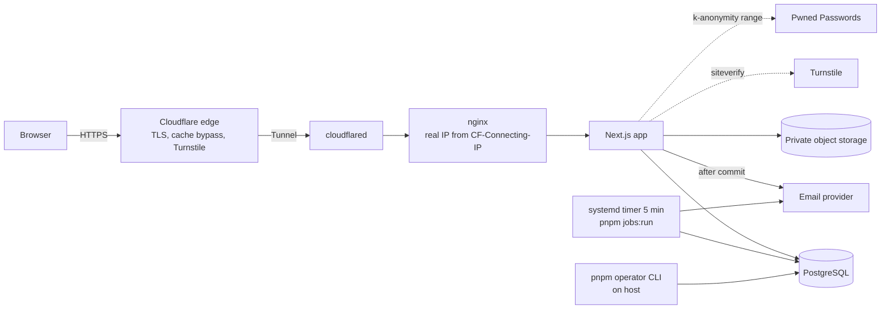
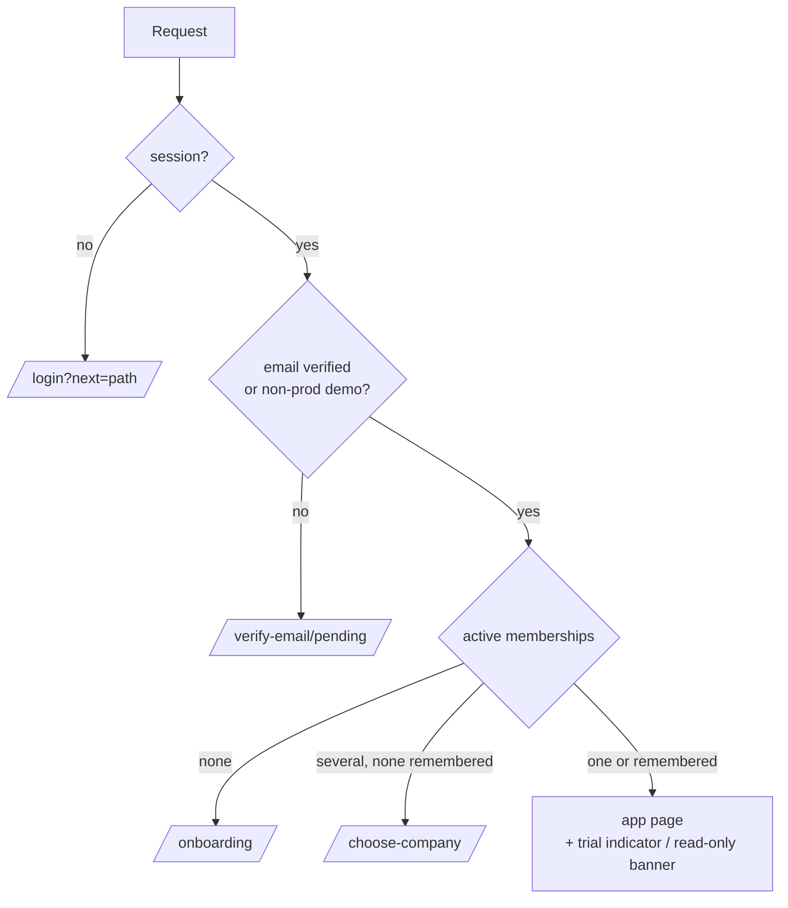

# Public sign-up, onboarding and trial: contracts (M6)

This is the design for [requirements](../requirements/public-signup-trial.md). Decisions and their reasons are in
[ADR 0004](../adr/0004-public-signup-and-trial.md). Tasks are in [public-signup-trial-tasks.md](public-signup-trial-tasks.md).
Names below are binding for the implementation tasks. Field lengths follow the requirements.

## Components



Server modules (all in `apps/web/src/server/`):

| Module | Responsibility |
|---|---|
| `account/` | Sign-up, verification, resend, forgot and reset; `account_tokens`; `terms_acceptances`; `platform_audit_events` |
| `email/` | Outbox enqueue, encryption, templates, `EmailTransport`, dispatcher and sweep |
| `onboarding/` | Atomic company creation; `setActiveCompany` API |
| `trial/` | `trialAccess` service (status, extend, set mode, requests), reminders |
| `operator/` | `withOperator`, `requireOperator`, operator projections, CLI commands |
| `security/turnstile.ts`, `security/pwned.ts` | External checks |
| `authz/read-only.ts` | `READ_ONLY_ALLOWED`, `ReadOnlyExemption`, `requireWritableActor` |

Pure date logic is in `packages/domain/src/trial.ts`.

## Data model changes

All changes are additive migrations with rollback files, except where noted. Enums are snake_case and `@@map`ped, as
in the existing schema.

### Enums

| Enum | Values |
|---|---|
| `company_access_mode` | `unrestricted`, `trial` |
| `account_token_purpose` | `email_verification`, `password_reset` |
| `audit_actor_kind` | `member`, `operator`, `system` |
| `platform_actor_kind` | `anonymous`, `user`, `operator`, `system` |
| `email_status` | `pending`, `sending`, `sent`, `failed`, `cancelled` |
| `trial_threshold` | `d7`, `d3`, `d1`, `ended` |
| `extension_request_status` | `pending`, `approved`, `declined`, `closed` |
| `document_kind` (existing) | add `company_logo` |

### `companies` (new columns)

| Column | Type | Rule |
|---|---|---|
| `access_mode` | `company_access_mode` NOT NULL DEFAULT `'unrestricted'` | CHECK `NOT is_demo OR access_mode = 'unrestricted'` |
| `trial_started_at` | timestamptz(3) NULL | |
| `trial_last_day` | date NULL | CHECK `access_mode <> 'trial' OR (trial_started_at, trial_last_day, read_only_from) all NOT NULL` |
| `read_only_from` | timestamptz(3) NULL | Set only by the BEFORE INSERT/UPDATE trigger: `((trial_last_day + 1)::timestamp AT TIME ZONE 'Australia/Sydney')`. Indexed `(access_mode, read_only_from)` |
| `trial_extension_count` | int NOT NULL DEFAULT 0 | ≥ 0 |
| `self_service_owner_id` | uuid NULL UNIQUE → `users.id` | Set only by onboarding. Enforces "one self-service company per user" |
| `self_service_request_key` | varchar(100) NULL | The onboarding `Idempotency-Key`. A retry with the same key returns the same company |
| `phone` | varchar(20) NULL | S6 format, checked in Zod |
| `business_email` | varchar(320) NULL | display only |
| `website` | varchar(200) NULL | CHECK `website ~ '^https?://'` |
| `about` | varchar(1000) NULL | plain text |
| `logo_document_id` | uuid NULL | FK `(id, logo_document_id)` → `documents(company_id, id)`. Document kind must be `company_logo` (trigger) |
| `setup_checklist_dismissed_at` | timestamptz(3) NULL | S5 AC8 |

The default `'unrestricted'` keeps old app versions and the demo seed working. Onboarding is the only path that sets
`trial`. **S13 backfill** happens in the same migration:

1. Existing rows take the default.
2. The migration inserts one `audit_events` row per company: `actor_kind = 'system'`,
   `action = 'company.access_initialised'`, `target = company`, metadata `{ changes: { accessMode: { before: null, after: "unrestricted" } } }`.
3. A migration test asserts that no company is read-only afterwards.

### `audit_events` (changed)

- Add `actor_kind audit_actor_kind NOT NULL DEFAULT 'member'`.
- Add `operator_user_id uuid NULL` → `platform_operators.user_id`.
- `created_by` becomes nullable.
- Add a CHECK:
  - `member`: `created_by` is set and `operator_user_id` is null;
  - `operator`: `operator_user_id` is set and `created_by` is null;
  - `system`: both are null.
- The existing composite FK to `memberships` stays, and it applies only when `created_by` is set.
- The append-only trigger is unchanged.
- **Write guard:** `CONSTRAINT TRIGGER audit_events_company_writable AFTER INSERT DEFERRABLE INITIALLY DEFERRED FOR
  EACH ROW EXECUTE FUNCTION jobflow_assert_company_writable()`.
  - It raises `55000` / `jobflow_company_read_only` when the company is `trial`, `read_only_from <= clock_timestamp()`,
    and `current_setting('jobflow.read_only_exemption', true)` is null or isn't in `jobflow_read_only_exemptions()`.

### New tables

| Table | Columns (all have `id uuid` PK and `created_at timestamptz(3)` unless noted) | Constraints |
|---|---|---|
| `account_tokens` | `user_id` → users, `purpose`, `token_hash char(64)`, `expires_at`, `consumed_at` NULL, `superseded_at` NULL | `token_hash` UNIQUE; partial UNIQUE `(user_id, purpose) WHERE consumed_at IS NULL AND superseded_at IS NULL`; index `(user_id, purpose, created_at)` |
| `terms_acceptances` | `user_id`, `terms_version varchar(40)`, `privacy_version varchar(40)`, `accepted_at` | Append-only (trigger); index `user_id` |
| `email_outbox` | `kind varchar(50)`, `dedupe_key varchar(200)`, `user_id` NULL, `company_id` NULL, `payload_ciphertext bytea` NULL, `status`, `attempts int`, `next_attempt_at`, `sent_at` NULL, `provider_message_id varchar(200)` NULL, `last_error varchar(100)` NULL (an error class, no message text) | `dedupe_key` UNIQUE; index `(status, next_attempt_at)`; CHECK payload is null when `status` is `sent` or `cancelled` |
| `email_suppressions` | `address_hash char(64)` PK (HMAC-SHA-256 of the lower-cased address, key per ADR 0004 D7), `reason varchar(20)` (`bounce`/`complaint`), `created_at` | |
| `email_webhook_events` | `provider varchar(20)`, `provider_event_id varchar(200)`, `received_at` | UNIQUE `(provider, provider_event_id)`; rows older than 30 days may be deleted by `jobs:run` |
| `trial_notifications` | `company_id`, `trial_last_day date`, `threshold`, `created_at` | UNIQUE `(company_id, trial_last_day, threshold)` |
| `user_notices` | `user_id`, `company_id` NULL, `notice_key varchar(100)`, `dismissed_at` NULL | UNIQUE `(user_id, company_id, notice_key)` |
| `trial_extension_requests` | `company_id`, `requested_by` (composite FK → memberships), `message varchar(1000)` NULL, `last_day_at_request date`, `status`, `decided_at` NULL, `decided_by` → `platform_operators.user_id` NULL, `extension_days int` NULL (1–365), `decision_note varchar(500)` NULL, `new_last_day date` NULL, `closed_reason varchar(30)` NULL (`direct_extension`/`made_unrestricted`) | Partial UNIQUE `(company_id) WHERE status = 'pending'`; CHECK status ↔ decision fields; decided rows are immutable (trigger); index `(status, created_at)` |
| `platform_operators` | `user_id` PK → users, `granted_at`, `granted_reason varchar(500)`, `granted_by varchar(100)`, `revoked_at` NULL, `revoked_reason varchar(500)` NULL | Changed only by the CLI. The runtime role has SELECT only |
| `platform_audit_events` | `actor_kind platform_actor_kind`, `user_id` NULL, `action varchar(100)`, `metadata jsonb` (redacted, ≤ 16 KiB), `request_id varchar(100)` NULL | Append-only (trigger); index `(user_id, created_at)` and `(action, created_at)` |
| `two_factor` (Better Auth) | per the plugin schema: `user_id`, `secret`, `backup_codes` | Plus `users.two_factor_enabled boolean NOT NULL DEFAULT false` |

### `quotes` (new column)

- `supplier_snapshot jsonb NULL`, set when the quote is sent.
- The existing frozen-after-send trigger must also freeze it.
- Quotes sent before this change keep `NULL` (S7 AC6).

### Runtime-role grants

- `jobflow_app` gets SELECT/INSERT/UPDATE on the new tables, except:
  - `platform_operators`: SELECT only;
  - `platform_audit_events` and `terms_acceptances`: INSERT and SELECT only.
- The operator CLI runs with the migration (owner) credentials.

## Company detail snapshot (S7)

`Invoice.supplierSnapshot` (on issue) and `Quote.supplierSnapshot` (on send) both use this shape. The shape is
versioned so that old documents read safely.

```ts
type SupplierSnapshotV2 = {
  v: 2;
  name: string; legalName: string | null; abn: string | null;
  addressLine1: string | null; addressLine2: string | null; suburb: string | null;
  state: string | null; postcode: string | null;
  phone: string | null; businessEmail: string | null; website: string | null;
  logoDocumentId: string | null;   // the company_logo document current at issue/send
  about?: string | null;           // quotes only
};
```

- **Readers.** Invoice and credit-note views and PDFs read V1 (no `v`) or V2. A field that's missing renders nothing.
  Quote views with `supplierSnapshot = null` after send show "Supplier details not recorded at send".
- **Drafts** render the live profile. **Issued documents** render the snapshot only.
- **PDF logo.** The renderer loads the snapshot's `logoDocumentId` bytes from private storage, inside the company
  scope, and embeds them with `pdf-lib` (`embedPng` or `embedJpg`). It never fetches a URL. The PDF renderer version
  bumps.
- The tax-invoice R4 fields are unchanged. The domain expert confirms this in the snapshot task.

## Logo storage (S6)

- **Upload.** `POST /api/company/logo` takes multipart, `company.update`, and a 2 MiB body limit.
- **Validation.**
  - The file signature must be PNG or JPEG. SVG and every other type are refused.
  - Dimensions are read from IHDR or SOF and must be at most 4000 × 4000.
- **Metadata stripping** is pure TypeScript, with no native image library:
  - PNG keeps only IHDR, PLTE, tRNS, IDAT and IEND;
  - JPEG drops APP1–APP15 and COM.
- **Storage.** The cleaned bytes are stored as a `documents` row with `kind = 'company_logo'` and a random key, using
  the existing `ObjectStore`. `companies.logo_document_id` is updated and `company.logo_changed` is audited, all in one
  transaction.
- **Failure.** If validation or the transaction fails, the stored object is deleted. If deletion fails, it's queued in
  `document_delete_retries`.
- **Replacing a logo** creates a new document and never overwrites one. Old logo documents are **excluded** from
  `documents:cleanup`, which never deletes `kind = 'company_logo'`, so any snapshot can still render them.
- **Display.**
  - `GET /api/company/logo/link` needs `company.read` and returns a 5-minute signed link through the existing
    `/api/files/[token]`.
  - `DELETE /api/company/logo` clears the reference only.

## Route map and redirects (S1)

The proxy (`apps/web/src/proxy.ts`) checks an explicit **public allowlist**. With no session cookie:

- a **page** outside the allowlist redirects to `/login?next=<path>`;
- an **API** route (`/api/*`) outside the allowlist gets `401 { code: "unauthenticated" }` JSON, never a redirect.

Every other decision is made on the server in layouts, with database state, because the proxy only sees whether a
cookie is present.

| Path | Kind | Allowed for |
|---|---|---|
| Pages: `/login`, `/signup`, `/signup/check-email`, `/verify-email`, `/forgot-password`, `/reset-password`, `/invite`, `/terms`, `/privacy` | public | everyone |
| APIs: `/api/health*`, `/api/auth/*`, and every `withPublic` or `withWebhook` route by method and path: `POST /api/account/sign-up`, `POST /api/account/verify-email`, `POST /api/account/verification/resend`, `POST /api/account/password/forgot`, `POST /api/account/password/reset`, **`POST /api/invitations/accept`**, **`POST /api/webhooks/email`** | public | everyone. The handler does its own token or signature check. The list is generated from the route wrappers and tested against them |
| `/verify-email/pending` | signed-in | unverified users |
| `/onboarding`, `/onboarding/details`, `/choose-company`, `/account` | signed-in | verified users, with no company needed |
| `/(app)/**` | app | active company member |
| `/operator/**` | operator | operators only. Everyone else gets **404** |
| `/design-previews`, `/design-system` | dev/staging | already 404 in production (`design/gate.ts`) |

Resolution order (in the signed-in layouts and `resolveActor`):



- **`next`.** Accepted only when it matches `^/(?!/|\\)[^\s]*$` and the path parses to the same origin. Anything else
  goes to `/home`.
- **Signed in.** A signed-in user on `/login` or `/signup` is redirected through the same resolution.
- **Invitations.** `/invite` stays reachable in every state (S12).

## API contracts

Every response is JSON with `Cache-Control: private, no-store`. Errors look like
`{ error: string, code?: string, fields?: Record<string,string> }`. Every mutation passes the origin check and has a
4 KiB body limit, except the logo upload.

### Public (`withPublic`)

| Method and path | Body | Responses | Throttle / Turnstile |
|---|---|---|---|
| POST `/api/account/sign-up` | `{ name, email, password, passwordConfirmation, acceptTerms: true, termsVersion, privacyVersion, turnstileToken }` | **202** `{ status: "check-email" }` for both new and existing emails; 400 with `fields` (validation, breached password, reserved TLD in production, stale terms version, non-ASCII local part); 400 `turnstile_failed`; 429 `{ retryAfterSeconds }`; 503 `signup_unavailable` | IP 5/h, Turnstile `signup`. For an existing address, at most 1 "account exists" email per hour and 3 per day per address HMAC; beyond that the same 202 is returned and nothing is sent |
| POST `/api/account/verify-email` | `{ token }` | 200 `{ status: "verified" \| "already-verified" }`; 400 `token_invalid` | IP 30/h |
| POST `/api/account/verification/resend` | `{ email, turnstileToken }` | **202** generic, always | IP 10/h, plus account 1/min and 5/day silently; Turnstile `resend` |
| POST `/api/account/password/forgot` | `{ email, turnstileToken }` | **202** generic, always | IP 10/h, account 3/h silently; Turnstile `forgot` |
| POST `/api/account/password/reset` | `{ token, password, passwordConfirmation }` | 200; 400 `token_invalid` or `fields` | IP 10/h |
| POST `/api/invitations/accept` (existing) | unchanged | adds 403 `company_read_only` when the invitation was created on or after `read_only_from`. Success now also sets `email_verified = true` (ADR 0004 D1) | unchanged |

### Webhook (`withWebhook`)

| Method and path | Body | Responses | Checks |
|---|---|---|---|
| POST `/api/webhooks/email` | The provider's signed event. For Amazon SES (#239): an SNS `Notification`, with SES's "include original headers" off | 204; 200 with no effect for an event already seen; 400 for a bad signature, stale timestamp or wrong topic (nothing logged beyond the reason class) | No origin check. Signature over the raw body before parsing (for SNS: SignatureVersion 2, certificate URL host `sns.ap-southeast-2.amazonaws.com`, `TopicArn` = `EMAIL_EVENTS_TOPIC_ARN`); timestamp ±5 min; `email_webhook_events` replay check; 64 KiB limit; IP throttle. A `SubscriptionConfirmation` is never followed automatically: the owner confirms it in the provider console |

### Signed-in account (`withSession`)

| Method and path | Body | Responses |
|---|---|---|
| POST `/api/account/verification/resend-mine` | none (`allowUnverified`) | 202 `{ retryAfterSeconds? }` (account 1/min, 5/day) |
| POST `/api/onboarding/company` | `{ businessName, gstRegistered, abn?, gstStartsOn?, gstBasis?, basPeriod?, legalName?, addressLine1?, addressLine2?, suburb?, state?, postcode? }`. Unknown keys such as `companyId`, `isDemo`, trial dates or `role` → 400 | 201 `{ companyId }`; **200 with the same `companyId`** on retry or race; 409 `self_service_limit`; 400 `fields` |
| POST `/api/session/company` | `{ companyId }` | 204; 404 when the user isn't an active member |
| POST `/api/notices/dismiss` | `{ noticeKey, companyId? }` | 204 |

### Company (`withPolicy`)

| Method and path | Permission | Notes |
|---|---|---|
| PATCH `/api/company` (existing) | `company.update` | Schema gains `phone`, `businessEmail`, `website`, `about`. Read-only → 403 `company_read_only` |
| POST / DELETE `/api/company/logo`, GET `/api/company/logo/link` | `company.update` / `company.read` | as described in Logo storage |
| POST `/api/company/setup-checklist/dismiss` | `company.update` | |
| GET `/api/company/trial` | `company.read` | `trial.read` holders (owner, manager, accountant) get `{ mode, phase, daysRemaining, lastDay, readOnlyFrom, supportEmail, extended }`. Others get `{ readOnly: boolean }` only |
| GET `/api/company/trial/extension-requests` | `trial.request_extension` | Current pending request plus the last 10 decisions |
| POST `/api/company/trial/extension-requests` | `trial.request_extension` | `{ message? }` → 201; 409 `request_pending`; 429 `{ retryAfterSeconds }` (3 per 7 days, 24 h after a decline); 403 when the company isn't a trial. **In `READ_ONLY_ALLOWED`** |

New permissions in `packages/authz`:

- `trial.read`: owner, manager, accountant.
- `trial.request_extension`: owner.

### Operator (`withOperator`, every failure → 404)

| Method and path | Body | Notes |
|---|---|---|
| GET `/api/operator/extension-requests?status=pending\|decided&page=` | | Pending oldest first. Projection: request, company `{ id, name, createdAt, mode, lastDay, phase }`, owner `{ name, email }` |
| POST `/api/operator/extension-requests/[id]/approve` | `{ days: 1–365, note? ≤ 500 }` | New last day = `max(current, yesterdaySydney) + days`. 409 when already decided |
| POST `/api/operator/extension-requests/[id]/decline` | `{ reason: 1–500 }` | 409 when already decided |
| GET `/api/operator/companies?q=&page=` | | Name search over non-demo companies only, same projection |
| POST `/api/operator/companies/[id]/extend` | `{ lastDay: "YYYY-MM-DD", reason }` | Must be later than the current last day, ≥ today (Sydney) and ≤ today + 365. Closes a pending request as approved |
| POST `/api/operator/companies/[id]/access` | `{ mode: "unrestricted" \| "trial", lastDay?, reason }` | `trial` needs `lastDay`. `unrestricted` closes a pending request (`made_unrestricted`). Demo company → 400 |

Every operator write runs through `trialAccess`, which does all of this in one transaction:

1. locks the company row (`jobflow_lock_company`);
2. validates;
3. updates;
4. resolves any pending request;
5. writes the company audit event (`actor_kind = 'operator'`, readOnlyExemption `operator`) with the before and after
   values, the reason and the `requestId`;
6. enqueues the owner emails.

Audit actions are `trial.extended`, `company.access_mode_changed`, `trial_extension.approved`,
`trial_extension.declined` and `trial_extension.requested` (by an owner).

### Operator CLI (`pnpm operator …`, host only)

| Command | Effect |
|---|---|
| `grant --user <uuid> --reason <text> --by <name>` | Inserts or reactivates `platform_operators`. The user's email must be verified. Writes `platform_audit_events` |
| `revoke --user <uuid> --reason <text> --by <name>` | Sets `revoked_at` and writes the audit event |
| `list` | Active operators: user ID, granted at, environment-allowlist match and MFA state |
| `extend --as <operatorUserId> --company <uuid> --last-day <date> --reason <text>` | Same as the extend API |
| `access --as <operatorUserId> --company <uuid> --mode <m> [--last-day <date>] --reason <text>` | Same as the access API |

The CLI refuses to run when `APP_ENV` is unset, or when `--as` isn't an active, allowlisted operator.

## Sequence: sign-up → verify → onboarding

```mermaid
sequenceDiagram
  actor U as Visitor
  participant W as Web (handlers)
  participant TS as Turnstile
  participant DB as PostgreSQL
  participant J as Dispatcher (after() / jobs:run)
  participant E as Email provider
  U->>W: POST /api/account/sign-up
  W->>TS: siteverify(token, action=signup)
  W->>DB: throttle hit (IP)
  W->>W: validate, breach check (fail-open), hash password
  alt new email
    W->>DB: TX: users + auth_accounts + terms_acceptances + account_tokens(digest) + email_outbox(verify) + platform_audit_events
  else existing email
    W->>DB: TX: email_outbox(account-exists) + platform_audit_events
  end
  W-->>U: 202 check-email (identical)
  W--)J: after(): dispatch
  J->>E: send (payload decrypted, then nulled)
  U->>W: open /verify-email#token → POST /api/account/verify-email
  W->>DB: TX: consume token, users.email_verified = true, audit
  U->>W: sign in (Better Auth) → /onboarding
  U->>W: POST /api/onboarding/company
  W->>DB: TX (one): lock user row FOR UPDATE; existing self-service company? same key → return it, else 409
  Note over W,DB: companies(access_mode=trial, trial_started_at=now(), trial_last_day=sydney(now)+29,<br/>self_service_owner_id) → memberships(owner) → company_gst_registrations?<br/>→ auth_sessions.active_company_id → audit: company.created, company.profile_set,<br/>gst_settings.registration_added?, trial.started
  W-->>U: 201 {companyId} → /onboarding/details or /home
```

- **Idempotency (S5 AC4).**
  - The client generates an `Idempotency-Key` (a UUID) once per onboarding form load and sends it with every submit.
  - The handler locks the user row, then looks for a company with `self_service_owner_id = user`.
  - If that company's `self_service_request_key` equals the header, the handler returns **200** with that company.
    This covers a double click, a retry or two tabs on the same form.
  - The `self_service_owner_id` UNIQUE constraint is the backstop: on a unique violation, the handler re-reads and
    applies the same rule.
- **Self-service limit (S5 AC5).** If such a company exists with a **different** key, the handler returns 409
  `self_service_limit` ("Contact us to set up another company") and creates nothing.

## Trial indicator and read-only UI

- The `(app)` layout gets `access` from the actor resolution: `{ mode, phase, daysRemaining, lastDay, readOnly }`, or
  for employees and subcontractors just `{ readOnly }`.
- The `TrialIndicator` (a `role="status"` landmark) and `ReadOnlyBanner` render from it.
- A `CompanyAccessProvider` React context lets forms disable create and edit controls with a one-line reason. The
  server stays authoritative.

## Operator area

- **Pages.** `/operator` (pending requests and recent decisions), `/operator/requests/[id]`, `/operator/companies`,
  `/operator/companies/[id]` and `/operator/mfa`.
- **Access.**
  - A separate layout calls `requireOperator()`, which runs `notFound()` on any failure.
  - It has no company shell, navigation or app links.
  - Company app pages ignore operator status completely.
- **Data.** Pages and APIs show only the S11 AC2 fields. Projections are positive allowlists in
  `server/operator/projections.ts`, with tests that assert the key sets.

## Read-only allowlist (initial)

These are the `READ_ONLY_ALLOWED` routes and their reasons. ADR 0004 D4 has the database exemption keys.

| Route | Reason |
|---|---|
| `POST /api/documents/[id]/link` | download link for an existing record |
| `POST /api/invoices/[id]/pdf` | PDF of an issued document (`record_rendering`) |
| `PATCH /api/users/[id]` | deactivation only (`access_removal`). A role change is refused at the database |
| `DELETE /api/users/invitations/[id]` | removes access (`access_removal`) |
| `POST /api/company/trial/extension-requests` | S14 (`trial_extension_request`) |
| `POST /api/session/company`, `POST /api/notices/dismiss` | `withSession`, not company data |

**Housekeeping that keeps running while read-only (S9 AC7):**

- `documents:cleanup` (`housekeeping`);
- the outbox sweep;
- trial reminders.

No other background job writes company records.
