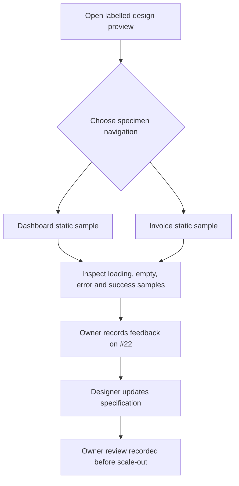
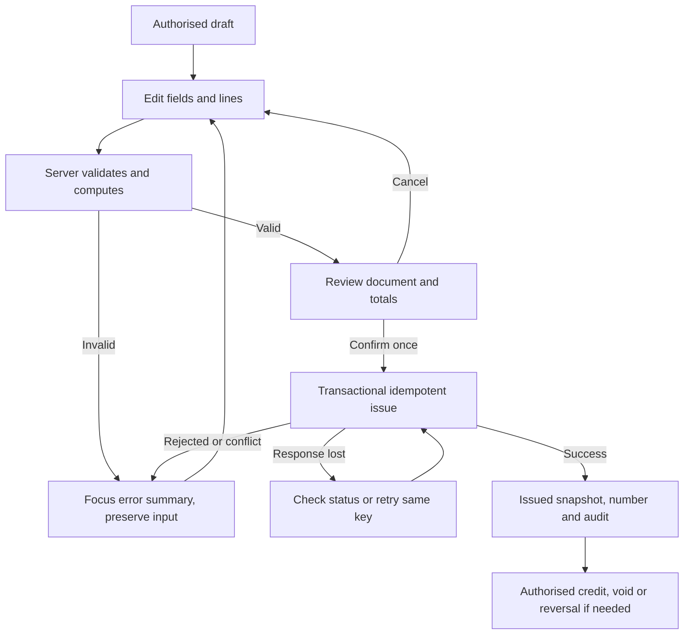
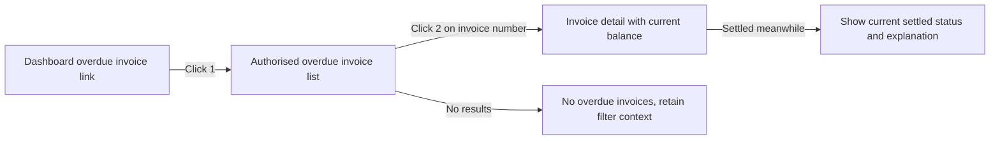

# Preview and future financial flows

These diagrams distinguish [M0 preview specimens](../review-22.md) from later real workflows. They define no functioning financial UI in M0.

## M0 review

No path saves, issues, pays, recalculates, exports or generates an invoice. A preview sample does not require database demo records; the shell's separate Demo Data indicator still follows database state.

## M3 issue, with failure paths

All paths check company and object permission; authentication failure leads to a safe access/login state, not the draft payload. Locked periods reject issue/correction as required by domain rules. A PDF error stays in the preview dialog and does not issue the draft.

## M4 overdue path

This path is an acceptance contract for the real M3/M4 modules. M0 labels the sample link unavailable instead of linking to nonexistent financial screens.
