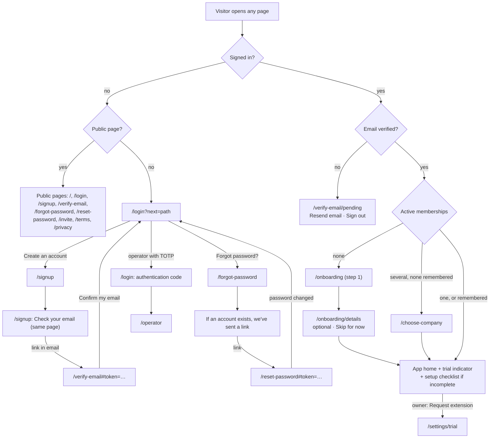

# Sign-up, verification, onboarding, trial and operator screens

Issue #208 (T4) · Epic #204 · Author: Claude B (ui-ux-designer), 5 November 2026 · Status: **for review**.

This is the UX contract for the M6 screens. The behaviour comes from the
[requirements](../requirements/public-signup-trial.md) (S1–S14), and the routes and APIs from
[ADR 0004](../adr/0004-public-signup-and-trial.md) and the [contracts](../architecture/public-signup-trial.md). It uses
the [design system](design-system.md): its tokens, `FormField`, `ErrorState`, `StatusPill`, `ConfirmDialog` and
`DataTable` contracts, and its responsive and accessibility rules. **The requirements' wording is binding.** Where an
implemented page in #249 or #250 differs, the last section lists the change to make.

## Shared patterns

These apply to every screen below unless the screen says otherwise.

### Account layout (signed-out and pre-company screens)

```text
┌─────────────────────────────────────────────┐
│ JobFlow                         [Theme ▾]   │  header: wordmark (link to /), theme only
├─────────────────────────────────────────────┤
│        ┌───────────────────────────┐        │
│        │ h1 Screen title           │        │  card, max-width 28rem (32rem onboarding)
│        │ one-line purpose          │        │
│        │ [error summary, if any]   │        │
│        │ fields…                   │        │
│        │ [Primary action]          │        │  one primary action per screen
│        │ secondary links           │        │
│        └───────────────────────────┘        │
│   Terms · Privacy · Contact admin@…         │  footer
└─────────────────────────────────────────────┘
```

- **No app navigation, company name or counts** on these screens (S1 AC1).
- One `main`, one `h1`. The skip link goes to `main`.
- At 320–360 px the card is full width with 16 px padding, and nothing scrolls sideways.

### Forms

- `FormField` throughout: a persistent visible label, help text linked with `aria-describedby`, and errors linked
  with `aria-describedby` plus `aria-invalid="true"`.
- **Validate** on blur (format only) and on submit (everything). Never clear typed values on an error, except password
  fields after a server rejection.
- **Failed submit:** an error summary at the top of the card (`role="alert"`, heading "There's a problem", one link
  per field error to that field). Focus moves to the summary heading.
- **Pending:** the primary button keeps its label, adds a spinner with text ("Creating account…"), and is
  `aria-disabled` so it can't be submitted twice. Other fields stay readable.
- **Throttled (429):** a status message in the card, "Too many attempts. You can try again in 4 minutes.", computed
  from the wait the server sends (`retryAfterSeconds` in the body on JobFlow routes; the `X-Retry-After` header, in
  seconds, on Better Auth's sign-in) and rounded up to whole minutes ("in 1 minute" for under 60 s). With no wait
  given, say "Too many attempts. Try again in a few minutes." and don't count down. The button stays
  disabled until then and counts down without moving focus. A screen reader is told once, through `role="status"`,
  not every second.
- **Generic failure (5xx or network):** "Something went wrong. Try again." with the button re-enabled. Typed values are
  kept. (The error shape is `{ error, code?, fields? }`; there's no reference ID to show.)
- **Success that ends the flow:** a dedicated success state (a new heading in the same card: an `h2` under the page's
  `h1`, as on `/signup` and `/verify-email`, or the `h1` itself when the card has none; focus moved to it), never a
  toast.

### Turnstile (S2 AC8, ADR 0004 D8)

- Rendered on **sign-up, forgot password and the public resend** form only, directly above the primary button, in
  the managed (usually invisible) mode.
- The primary button is enabled once a token exists. Until then, a hint under the widget reads "Checking you're not
  a robot…" (`role="status"`).
- **Accessible fallback:**
  - If Cloudflare shows an interactive challenge, it sits in the tab order straight after the last field, inside a
    group labelled "Security check". The page can't move focus into Cloudflare's cross-origin frame, so it doesn't try;
    the hint text says "Complete the security check below" instead.
  - If the widget fails to load within 10 s or reports an error, show "The security check didn't load. Reload the
    page and try again. If it keeps failing, email {SUPPORT_EMAIL}." with a "Try again" button that re-renders the
    widget. The same text is used on sign-up, forgot password and resend; it promises no manual set-up. The form
    never silently waits.
  - Turnstile's own frame meets its accessibility statement. The page doesn't rely on colour or images for it.
- The server error `turnstile_failed` shows "We couldn't complete the security check. Try again." The widget resets
  and the typed values are kept.

## Flow



Rendered and checked with `mmdc` (Mermaid CLI).


- **Deep links survive sign-in:** `next` holds the original path, and only same-origin relative page paths are kept
  (S1 AC2).
- **Pre-company and pending screens** say who is signed in and offer "Sign out". After signing out, the user is on
  `/login`.

## Screens

Copy in quotes is the exact text. "Support address" means the configured `SUPPORT_EMAIL`, which defaults to
`admin@shivomsangha.com`.

### 1. Sign in · `/login`

| Element | Spec |
|---|---|
| Title | h1 "Sign in to JobFlow" |
| Fields | Email (`autocomplete="username"`), Password (`autocomplete="current-password"`, with a "Show password" toggle button that has an accessible name and pressed state) |
| Primary | "Sign in" |
| Links | "Forgot password?" → `/forgot-password` (next to the password field); **"Create an account"** → `/signup`, shown as a secondary button-styled link below the form, prominent (S1 AC1) |
| Error | Wrong email or password: "Email or password is incorrect." (summary + both fields, never saying which) |
| Throttled | Better Auth answers 429 with `X-Retry-After` (seconds): "Too many sign-in attempts. You can try again in N minutes." |
| Operator with TOTP | After a correct password, the same card shows the authentication-code step (§13e) instead of signing in |
| Unverified | Sign-in succeeds and the user is sent to `/verify-email/pending` (S3 AC4) |
| After success | `next` if it's valid, otherwise the routing in the flow above |

### 2. Sign up · `/signup`

| Element | Spec |
|---|---|
| Title | h1 "Create your JobFlow account" · purpose "Start a free 30-day trial. No card needed." |
| Fields | **Your name** (`autocomplete="name"`, 1–200) · **Email** (`autocomplete="email"`, help "We'll send a link to confirm it.") · **Password** (`autocomplete="new-password"`, help "At least 12 characters. A short phrase works well.") · **Confirm password** · checkbox **"I agree to the [Terms] and [Privacy policy]"** (links open in a new tab, with "(opens in new tab)" in their accessible names) · Turnstile |
| Primary | "Create account" → pending "Creating account…" |
| Secondary | "Already have an account? Sign in" |
| Invitee hint | Under the title, muted: "Invited to join a company? Use the link from your company owner instead." (S5 AC9) |
| Field errors | Name: "Enter your name" / "Use 200 characters or fewer". Email: "Enter an email address like name@example.com" / "Use an email address with only English letters, numbers and symbols before the @". Password: "Use at least 12 characters" / "Use 128 characters or fewer" / breached: "This password has appeared in a data breach. Choose a different one." Confirm: "Passwords don't match". Terms: "Tick to agree to the terms and privacy policy". Reserved domain (production): "Use a real email address you can receive mail at". Stale terms version: "The terms have changed. Reload the page to read the new version." |
| Server-only | `signup_unavailable` (503): replace the form with "Sign-up isn't open yet. Email {SUPPORT_EMAIL} to request early access." (production legal gate, E5) |
| Throttled | "Too many sign-up attempts from this network. You can try again in N minutes." |
| Success | **Same page, no navigation.** The form is replaced in place (React state) by h2 **"Check your email"** with `role="status"`, and focus moves to it. Body: "Check your email to verify your address. We've sent a link to **{email}** that works for 24 hours, then sign in to set up your business." (S2 AC1's wording comes first.) Then "Nothing arrived? Check your spam folder, or [request a new link]", which goes to `/verify-email` (the public resend form, §5). The email is shown from the form's own state and is never put in the URL or browser storage. Identical for new and existing emails (S2 AC4). |
| Reload after success | The page is a fresh sign-up form again; nothing about the earlier submission is kept. The user can still use the email they were sent, or "request a new link" from `/verify-email`. There is no missing-email state, because the email is never read from anywhere but the form. |

### 3. Verify link landing · `/verify-email#token=…`

The token lives in the URL fragment. The page sends `Referrer-Policy: no-referrer`, reads the fragment, and removes it
from the address bar at once (`history.replaceState`). **The token is spent only when the user presses "Confirm my
email"**, never on page load. That way a mail scanner that runs scripts can't verify an address on someone's behalf
(pre-account hijack). This differs from S3 AC2, which says opening the link verifies: the press is one extra step.

| State | Content | Next |
|---|---|---|
| Reading the link | "Checking your link…" with `role="status"` (one frame, usually unseen) | none |
| Pre-click | Page h1 "Verify your email" (it stays for every state below) · "Press the button to confirm this email address is yours." · primary **"Confirm my email"** | Focus on the button |
| Pending | The button reads "Confirming…" and is `aria-disabled`; a second press does nothing | none |
| `verified` or `already-verified` (200) | h2 "Email verified" · "Thanks. Sign in to set up your business." · primary "Continue" (→ `/login`, or the S1 routing if already signed in). Both statuses look the same, so the page doesn't reveal whether the link had been used | Focus on the h2 |
| `token_invalid` (400) | Alert (`role="alert"`) "This link is invalid or has expired." · h2 "Get a new verification link" · the public resend form (§5) | Focus on the alert |
| No token in the URL | h2 "Get a new verification link" · the public resend form (§5), without the alert | none |
| Network error | Alert "Check your connection and try again." and the **"Confirm my email" button stays**, enabled again, because the token hasn't been spent (it's still held in memory) | Focus on the alert |

### 4. Pending verification · `/verify-email/pending` (signed in, unverified)

| Element | Spec |
|---|---|
| Title | h1 "Check your email" (as built in #249) |
| Body | "Your email address **{email}** needs to be verified. Open the link we emailed you, or send a new one below." · muted: "The link expires after 24 hours. Requesting a new one cancels the old link." |
| Primary | "Resend email" (account resend; no Turnstile, because the session is the proof) |
| Secondary | "Sign out" (a button styled as a link) |
| Success | Status: "A new link is on its way. Check your inbox and spam folder." |
| Throttled | **429** with `retryAfterSeconds` in the body and a `Retry-After` header (as `resend-mine` returns): "You can request another link in N minutes." (or "in N hours" from 90 minutes up). The 1-a-minute and 5-a-day limits (S3 AC5) are both expressed through that one wait; the page doesn't tell them apart. Below the status, always: "Still stuck? Email {SUPPORT_EMAIL}." |

### 5. Public resend · within `/verify-email` (invalid link) and linked from "Check your email"

- Fields: Email and Turnstile. Primary: "Send a new link".
- Always the same success message: "If that address needs confirming, we've sent a new link." There's no
  enumeration, and throttling looks identical (S3 AC5).

### 6. Forgot password · `/forgot-password`

| Element | Spec |
|---|---|
| Title | h1 "Reset your password" · "Enter your account email and we'll send you a link." |
| Fields | Email · Turnstile |
| Primary | "Send reset link" |
| Success | Always: h1 "Check your email" · "If an account exists for **{email}**, we've sent a link to reset your password. It expires in 1 hour." (S4 AC1). Throttled requests show this too. |
| Links | "Back to sign in" |

### 7. Reset password · `/reset-password#token=…`

| Element | Spec |
|---|---|
| Title | h1 "Choose a new password" |
| Fields | New password (`new-password`, the same help and errors as sign-up, breached check included) · Confirm |
| Primary | "Change password" |
| Success | h1 "Password changed" · "You've been signed out everywhere. Sign in with your new password." · primary "Sign in" (S4 AC3) |
| `token_invalid` | h1 "This link is invalid or has expired" · "Reset links work once and expire after an hour." · primary "Send a new link" (→ `/forgot-password`) |

### 8. Onboarding step 1 · `/onboarding` (verified, no company)

Card width is 32rem. A stepper text above the h1 reads "Step 1 of 2" (no clickable steps).

| Element | Spec |
|---|---|
| Title | h1 "Set up your business" · "This creates your company and starts your free 30-day trial." |
| Invitee hint | "Invited to join a company? Use the invitation link from your owner instead." (S5 AC9) |
| Required | **Business name** · fieldset **"Are you registered for GST?"** with radios "Yes, I'm registered for GST" / "No, not registered" |
| If Yes | **ABN** (required, `inputmode="numeric"`, help "11 digits. Spaces are fine.") · **GST registration date** (date) · **GST accounting basis** (select, required, **no default**: it starts on "Choose…", because guessing cash or accruals wrong changes the owner's BAS) with "Cash" / "Accruals (non-cash)" · **BAS reporting period**: "Quarterly" (default) / "Monthly". These are revealed below the radio and announced: the new fields follow the radio in the DOM, and focus doesn't move. |
| If No | **ABN (optional)** |
| Optional | **Legal name (optional)**, help "If it differs from your business name." · address: Street address, Address line 2, Suburb, **State** (select of the 8 codes), Postcode (4 digits) |
| Primary | "Create my business and start the free trial" → "Setting up your business…" |
| Field errors | Business name: "Enter your business name" / "Use 200 characters or fewer". GST question: "Choose whether you're registered for GST". ABN: "Enter your ABN" (when registered) / "Enter an 11-digit ABN" / "This ABN isn't valid. Check the digits." Date: "Enter the date your GST registration started". Basis: "Choose cash or accruals". Postcode: "Enter a 4-digit postcode". The server's `fields` messages are shown as sent when they differ. |
| `self_service_limit` (409) | **With `alreadyMember: true`** (a second tab after the first created the company, or a stale page): no screen, the form goes straight to `/home`, where the company now is. **Without it** (the user created a company but is no longer an active member of it): replace the form with h1 "You've already set up a company" · "Each account can create one company itself. Email {SUPPORT_EMAIL} to set up another." · "Sign out" (S5 AC5). |
| Leaving | Nothing is saved before submit; no browser storage (S5 AC8). |
| Success | → `/onboarding/details` (step 2). The session's company is set. |

### 9. Onboarding optional details · `/onboarding/details` (Step 2 of 2; S6)

- h1 "Add your contact details". Text: "Shown on your quotes and invoices. You can change these later in Settings."
- **Fields:**
  - Phone: `tel`. Error: "Enter a phone number with 8–15 digits".
  - Business email: prefilled with the login email. Help: "Shown on documents. It isn't used to sign in."
  - Website: `url`. Error: "Enter a web address starting with http:// or https://".
  - About your business: textarea with a live "N of 1000 characters" count in `aria-describedby`, updated politely.
  - Logo: a `FileUploader` with the help text "PNG or JPEG, up to 2 MB and 4000 × 4000 px." It shows a preview (with
    alt text "Your logo"), "Replace" and "Remove". Errors: "Upload a PNG or JPEG file" / "The file is larger than
    2 MB" / "The image is larger than 4000 × 4000 px".
- **Primary:** "Save and continue". **Secondary:** "Skip for now". Both go to `/home`.
- While read-only, this screen is reached only from Settings, and the pattern in [Read-only controls](#read-only-controls) applies.

### 10. Setup checklist · on `/home` (S5 AC8)

```text
┌ Finish setting up your company ─────────────── [Dismiss] ┐
│ ✓ Business details                                       │
│ ○ Contact details  → Add                                 │
│ ○ Logo             → Add                                 │
│ ○ About your business → Add                              │
└──────────────────────────────────────────────────────────┘
```

- It's a `section` with h2 "Finish setting up your company" and a list.
- Each item has a text state ("Done" or "To do") as well as its icon, so state isn't conveyed by colour or icon
  alone. "Add" links go to Settings → Company.
- **Dismiss** asks no confirmation, sets `setup_checklist_dismissed_at`, and moves focus to the page h1. The
  checklist also disappears once every item is done.
- **Owners only.** It's hidden while the company is read-only.

### 11. Company chooser · `/choose-company`

| Element | Spec |
|---|---|
| Title | h1 "Choose a company" · "You belong to more than one company." |
| List | One button per active membership: "**{Company name}** · {Role}". The button's accessible name is "Open {Company name}". **Trial text depends on the role in that company** (S8 AC2): owner, manager and accountant rows add "Trial ends in N days" in the warning and critical phases and "Read-only" when expired; employee and subcontractor rows add "Read-only" when expired and nothing otherwise. The chooser never needs more than `{ readOnly }` for worker rows. |
| Actions | "Create a company" (only if the self-service limit isn't used) · "Sign out" |
| Error | "We couldn't open that company. Try again." (a 404 when the membership is no longer active refreshes the list) |
| Empty | Never shown: no memberships routes to onboarding instead. |

The account menu on every app page gains "Switch company" (when there's more than one) and "Create a company" (S12 AC3).

### 12. Trial settings and request extension · `/settings/trial`

Who sees what follows the permission contract: `GET /api/company/trial` needs `trial.read` (owner, manager,
accountant); the extension-request API needs `trial.request_extension` (**owner only**), both to list and to submit.

```text
h1 Trial
┌ Status ─────────────────────────────────────────┐
│ [StatusPill] 5 days remaining                    │
│ Trial ends 1 Dec 2026 · Read-only from 12:00 am  │
│ on 2 Dec 2026 (Sydney time)                      │
│ Extended  (only when extended)                   │
└──────────────────────────────────────────────────┘
┌ Request more time (owner only) ──────────────────┐
│ Message (optional)  [textarea, 0 of 1000]        │
│ [Request extension]                              │
│ Or email {SUPPORT_EMAIL}                         │
└──────────────────────────────────────────────────┘
┌ Past requests (owner only) ──────────────────────┐
│ DataTable: Requested · Status · Decided · Outcome│
└──────────────────────────────────────────────────┘
```

| State or role | Content |
|---|---|
| Status, critical phase | "Last day of your trial · Read-only from 12:00 am tomorrow (Sydney time)", exactly as the indicator |
| Form (owner, no pending request) | Field "Message (optional)": plain text with a live count. Primary "Request extension". |
| Pending (owner) | Replace the form: StatusPill "Pending" + "Requested 3 Dec 2026, 9:14 am. We'll email you when it's decided." No form (S14 AC3). |
| Success | Status: "Request sent. We'll email you when it's decided." plus "You can also email {SUPPORT_EMAIL}." (S14 AC2). Focus goes to the status. |
| Throttled (429) | "You can send another request in N hours." (from `retryAfterSeconds`; "on 10 Dec 2026" when over 48 hours), plus the support address (S14 AC4) |
| `request_pending` (409) | Re-render as Pending. |
| Past requests outcomes | "Approved: extended to 15 Dec 2026", "Declined: {reason}" (escaped text), "Closed: extended directly" (`closed_reason = direct_extension`), "Closed: no longer a trial" (`made_unrestricted`), or "Pending". The operator's approval **note is never shown to owners**, and the deciding operator appears only as "JobFlow operator" (ADR D6). |
| Manager or accountant | The status card, then a plain line: "Only an owner can request more time. You can also email {SUPPORT_EMAIL}." No form, no button and no request history, because the API refuses them. |
| Employee or subcontractor | Not linked anywhere. A direct visit renders the normal "page not available" 404 view (the API gives them only `{ readOnly }`). |
| Unrestricted or demo | The page shows "This company isn't on a trial." with no form, and isn't linked in navigation. |

The approved and declined messages are delivered by the one-time notices below, not by this page.

### 12a. One-time notices · `user_notices` (S10 AC3, S14 AC9)

A notice is a dismissible `role="status"` panel at the top of the app's main content (below the trial banner), shown
once per user, company and key. Dismissing it calls `POST /api/notices/dismiss` with `{ noticeKey, companyId }` and
moves focus to the page h1. **Threshold notices** (`trial.threshold.*`) are also treated as seen once shown, so moving to
another page retires them. **Extension notices** (`trial.extended:*`, `trial.declined:*`) show on every page load until
dismissed (S14 AC9). Owners only, and never for demo or unrestricted companies.

| Key (`notice_key`, ≤ 100 chars) | When | Copy |
|---|---|---|
| `trial.threshold.7:<lastDay>` | First owner sign-in with 4–7 days left | "Your trial ends on 1 Dec 2026. Request an extension in Settings → Trial, or email {SUPPORT_EMAIL}." · action "Request extension" |
| `trial.threshold.3:<lastDay>` | First sign-in with 2–3 days left | "N days left in your trial. After 1 Dec 2026 your company becomes read-only." (N is 2 or 3) · same action |
| `trial.threshold.1:<lastDay>` | First sign-in on the last day | "Today is the last day of your trial. Your company becomes read-only from 12:00 am tomorrow (Sydney time)." · same action |
| `trial.threshold.ended:<lastDay>` | First sign-in once read-only | "Your trial ended on 1 Dec 2026. You can still view and export your records. Request an extension to keep working." · same action |
| `trial.extended:<newLastDay>` | After an approval or a direct extension | "Your trial was extended to 15 Dec 2026." |
| `trial.declined:<requestId>` | After a decline | "Your extension request was declined: {reason}". The reason is escaped text. |

- `<lastDay>` is the ISO date, so an extension re-arms every threshold (S10 AC4).
- When several thresholds apply at once, only the latest is shown (S10 AC2's rule, applied in-app).
- Notices don't replace the indicator; the indicator is always there (S10 AC3).

### 13. Operator area · `/operator/**` (operators only; everyone else gets 404)

This uses a **separate minimal layout**: a "JobFlow operator" wordmark, the operator's email, "Sign out", and **no
company shell or company links**. A persistent strip reads "Operator area · actions are audited".

**13a. Requests list · `/operator`**

- h1 "Extension requests". Tabs "Pending (N)" / "Decided" (with `aria-selected`).
- **Pending** is a `DataTable`, oldest first, with columns: Requested, Company, Owner, Last day, Phase (a StatusPill
  with text), and a "Review" link.
- **Empty:** "No pending requests." **Decided:** the last 50, newest first, showing the outcome and operator.
- **Never shown:** company records such as customers, jobs or invoices (S11 AC2).

**13b. Request detail · `/operator/requests/[id]`**

- A definition list: Company, Created, Trial state, Last day, Owner name and email, Requested, Message (escaped, with
  line breaks kept).
- **Approve:** "Extend by [number, 1–365] days". Help: "New last day: {computed}". The computed date is shown
  live from `max(last day, yesterday) + days` (S14 AC7). An optional Note (≤ 500), with the help text "For the
  operator log only. The owner doesn't see it." Primary "Approve".
- **Decline:** Reason (required, 1–500). Button "Decline", styled destructive.
- Both actions open a `ConfirmDialog`: "Extend {Company} to 15 Dec 2026?" / "Decline this request?". Initial focus is
  on Cancel.
- **409 (already decided):** "This request was already decided by another operator." Reload the page to see the result.

**13c. Companies · `/operator/companies` and `/operator/companies/[id]`**

- A search field "Company name". Results show name, created date, mode and phase. Demo companies are never listed.
- **Detail actions:**
  - "Extend trial": a date input, validated as later than the current last day, ≥ today, and ≤ today + 365. Errors:
    "Choose a later day than the current last day" / "Choose today or later" / "Choose a day within a year".
  - "Change access": radios Trial / Unrestricted. Trial needs a last day.
  - Both need a **Reason** (1–500) and go through a `ConfirmDialog`.

**13d. MFA enrolment · `/operator/mfa`** (the only operator page before TOTP is set up)

1. **Enrolment code:** h1 "Set up two-factor authentication". Step 1, "Enter your enrolment code": a text field. Help:
   "Ask for a code on the server: `pnpm operator enrol-code --user <id>`. Codes work once, for 10 minutes." Error:
   "That code is invalid or has expired."
2. **Authenticator app:**
   - It shows a QR code with alt text "QR code for your authenticator app", **plus the secret as text**, grouped in
     fours, with a "Copy" button. That way a screen-reader user, or someone without a camera, can enrol by typing it
     in.
   - Then "Enter the 6-digit code", with `inputmode="numeric"` and `autocomplete="one-time-code"`.
3. **Backup codes:** these are shown once, as a list, with "Download" and "I've saved these" (which must be ticked to
   finish).
4. **Success:** "Two-factor authentication is on." with a link to "Go to the operator area".

**13e. Authentication-code step · on `/login`** (operators with TOTP; ADR D5)

Better Auth's `twoFactor` plugin answers a correct password with a "two-factor required" result and no session yet.
The sign-in card then changes in place (no new route, so `next` is kept):

| Element | Spec |
|---|---|
| Title | h2 "Enter your authentication code" (focus moves here) · "Open your authenticator app and enter the 6-digit code for JobFlow." |
| Field | "Authentication code": `inputmode="numeric"`, `autocomplete="one-time-code"`, paste allowed. Spaces and dashes are stripped **as the value changes**, and only then is it held to 6 digits, so a pasted "123 456" becomes "123456". No `maxlength` attribute, which would cut the paste before stripping |
| Primary | "Verify" → "Verifying…" |
| Secondary | "Use a backup code instead": swaps the field for "Backup code" (text, `autocomplete="off"`), with "Use your authenticator app" to swap back · "Cancel and sign out" (returns to the sign-in form) |
| Wrong code | "That code didn't work. Check your app and try the newest code." (field error and summary; the field is cleared) |
| Wrong backup code | "That backup code didn't work. Each code works once." |
| Throttled | Better Auth 429 with `X-Retry-After`: "Too many attempts. You can try again in N minutes." The field stays filled; the button is disabled until then. |
| No Access session | `/login` isn't behind Cloudflare Access but `/api/auth/two-factor/*` is (ADR D5), so an operator without an Access session gets an Access page or redirect instead of JSON from Verify. The step treats any non-JSON or 401/403 reply from that call as: "Your operator sign-in needs Cloudflare Access first. Open {APP_URL}/operator to sign in to Access, then sign in here again." (inferred from D5; check on the host, #232) |
| Expired step | Better Auth's pending two-factor cookie lasts a few minutes: "Your sign-in timed out. Sign in again." and the password form returns |
| Success | → `next` (only `/operator…` paths for an operator) or `/operator` |
| Lost device | A muted line under the form: "Lost your device? Ask for a new enrolment code on the server (`pnpm operator enrol-code --user <id>`), then set up two-factor again at /operator/mfa. Until then, the CLI does every operator task." No self-service recovery exists, by design. |

**13f. Cloudflare Access denied.** Requests to `/operator*`, `/api/operator/*` and `/api/auth/two-factor/*` from an
identity the Access policy doesn't allow never reach the app: Cloudflare shows its own "Access denied" page. JobFlow
can't style or change that page, and nothing in the app links there for non-operators, so ordinary users never meet
it. For the operator, the runbook (#232) says to sign in to Cloudflare Access with the allowed identity first.

## Trial indicator and banner (S8)

The trial indicator is a single component in the app shell's top bar, on every page and at every breakpoint. Its
contract:

- **Element:** a `role="status"` region labelled "Trial status". Its text is announced when the page loads, and
  re-announced only when the phase changes.
- **Content:** an icon, then the text. **The text carries the state**, so colour is never the only cue (S8 AC3).
- **Mobile:** it stays a full-width bar under the header, and never collapses into an icon.

| Phase (N = days remaining) | Owner | Manager / Accountant | Employee / Subcontractor |
|---|---|---|---|
| **normal** (N ≥ 8) · neutral `muted` · clock icon | Indicator: "N days remaining" · no banner | Same as owner | Nothing |
| **warning** (2–7) · `warning` · alert icon | Indicator: "N days remaining · Trial expires on 1 Dec 2026". Banner: "Your trial ends on 1 Dec 2026. Request more time, or email {SUPPORT_EMAIL}." with **[Request extension]**. Dismissible for the session | Same text and banner **without** "Request extension" | Nothing |
| **critical** (1) · `danger` · alert icon | Indicator: "Last day of your trial · Read-only from 12:00 am tomorrow (Sydney time)". Banner as for warning, saying "today". **Not dismissible** | Same, without the action | Nothing |
| **expired** (≤ 0) · `danger` · lock icon | Indicator: "Trial ended 1 Dec 2026 · Read-only". Banner: "Your company is read-only. You can still view and export your records. Request an extension, or email {SUPPORT_EMAIL}." with **[Request extension]**. **Not dismissible** | Banner without the action, and "You can still view and export your records." | Banner only: **"This company's account is read-only. Contact your owner."** No dates and no support address (S8 AC2) |
| unrestricted or demo | Nothing (S8 AC6) | Nothing | Nothing |

- **Dates and times:**
  - dates are `d MMM yyyy`, and times are given with "(Sydney time)";
  - "N days" uses "1 day" in the singular;
  - the banner says "today" in the critical phase.
- **Placement and focus:**
  - the banner sits under the top bar, as a `section` labelled by its own heading text, with the `aria-label`
    "Trial";
  - dismissing it moves focus to the page h1;
  - nothing in the banner traps focus, and it never covers content (no sticky overlay).
- **Request extension** goes to `/settings/trial`.

## Read-only controls (S9 AC5)

The server is authoritative (403 `company_read_only`). The UI only avoids dead ends.

- **Create and edit actions:**
  - page-header primary actions ("New invoice") and row actions ("Edit", "Issue", "Void") render **disabled, not
    hidden**, using `aria-disabled="true"` so they stay focusable and announced;
  - each has a one-line reason linked through `aria-describedby`: "Read-only: the trial has ended.";
  - workers see "Read-only: contact your owner." instead.
- **Forms opened from bookmarks:**
  - the fields render read-only with the same one-line reason at the top;
  - the submit button is disabled;
  - nothing claims to be saved.
- **Still enabled:**
  - every view, filter and search;
  - exports (CSV and the company export) and PDF download of issued documents;
  - deactivate member, revoke invitation;
  - sign out, switch company and Request extension.
- **If a 403 still arrives** (another tab, or a race at midnight):
  - show the inline error "This company's account is read-only, so this change can't be saved." (the server copy);
  - keep the typed values so they can be copied;
  - refresh the trial status, so the banner appears without a reload.
- **Never:**
  - a success toast for a refused write;
  - removing navigation;
  - hiding data the role could see before.

## Accessibility acceptance (WCAG 2.2 AA)

The design system's rules apply in full. In addition, for these screens:

- **Keyboard:**
  - DOM order equals visual order: header → error summary → fields in order → primary → secondary links → footer;
  - nothing gets a positive `tabindex`;
  - the password "Show" toggle comes straight after its field;
  - the Turnstile frame, when interactive, sits between the last field and the primary button.
- **Focus:**
  - it's always visible (the `focus-ring` token, 3:1) and never covered by the top bar or banner (2.4.11);
  - after a failed submit it goes to the error summary;
  - after a success state, to its heading;
  - after a dialog closes, back to the button that opened it.
- **Errors:**
  - every error is text, linked to its field (`aria-describedby` + `aria-invalid`) and listed in the summary;
  - none is colour-only;
  - server messages are shown as text, never HTML.
- **Reflow:**
  - 320 px wide at 400 % zoom with no sideways scroll;
  - tables in the operator area scroll inside a labelled, focusable region;
  - the onboarding address fields stack.
- **Contrast:** only the token pairs in the design system (light and dark), with text at ≥ 4.5:1 and control
  boundaries at ≥ 3:1. Status uses `warning`, `danger` or `muted` pills **with icon and text**.
- **Target size:** every target is ≥ 24 × 24 px (2.5.8); the design system's 44 px is preferred.
- **Authentication (3.3.8, accessible authentication):**
  - no cognitive test: paste is allowed in every password and code field, and the TOTP secret is shown as text for
    copying;
  - password managers work (`autocomplete` values above);
  - Turnstile's managed mode needs no puzzle, and the fallback message gives an email route.
- **Timing:**
  - throttle countdowns never auto-submit;
  - link expiry is stated in the copy;
  - no session timeout warning is in scope.
- **Language:** `lang="en-AU"`. Australian spelling ("organisation", "licence").
- **Screen reader announcements:** the trial status on load, the pending, success and throttled messages
  (`role="status"`), and error summaries (`role="alert"`, once).

**Tests (#235, T31):**
- axe in light and dark at 360 and 1440 px for every screen above;
- keyboard-only completion of sign-up → verify → onboarding → request extension;
- Turnstile shown and unavailable states, using Cloudflare's test keys;
- the indicator text for each phase and role.

## Differences from the current build

What `main` (at `85ba5b8`, with #249 merged) and the open #250 build, and what this spec changes. The requirements'
wording wins. #224 resolves the rows marked **to fix**.

| Where (PR, file) | Built there | Change to |
|---|---|---|
| Trial banner, normal (`components/shell/banners.tsx`) | "N days remaining" | Done in #226 |
| Trial banner, critical | "Last day of your trial · Read-only from 12:00 am tomorrow (Sydney time)" | Done in #226 |
| Trial banner, expired, owner | "Trial ended 1 Dec 2026 · Read-only" plus the banner | Done in #226 |
| Trial banner, expired, workers | "This company's account is read-only. Contact your owner." | Done in #226 |
| Warning phase | "N days remaining · Trial expires on 1 Dec 2026" + dismissible banner, Request extension for owners | Done in #226 |
| Sign-up success (main, `signup-form.tsx`) | h2 "Check your email" · "We've sent a link to verify your address. Open it within 24 hours, then sign in…" | Keep the in-place h2. Lead with S2 AC1's "Check your email to verify your address", then the address and expiry (§2) |
| Sign-up route (architecture lists `/signup/check-email`) | Built in place on `/signup` | **Accepted deviation:** in place, so the email never travels in a URL. The architecture's route list should drop `/signup/check-email` |
| Verify link (main, `verify-client.tsx`) | "Confirm my email" button; token spent on press; h2 "Email verified"; invalid as an alert plus h2 | Matches §3, whose headings now follow the build. **Deviation from S3 AC2** ("opening the link verifies"): one press, against mail-scanner pre-account hijack |
| Verify network error (main, `verify-client.tsx`) | The button goes and the resend form shows | **To fix:** keep the button with an alert (§3), because the token is still unspent |
| Resend throttle (main, `account/handlers.ts`, `verify-client.tsx`) | 429 with `retryAfterSeconds` and `Retry-After`; the page says "Too many requests. Try again later." | **To fix:** show the wait, "You can request another link in N minutes." (§4) |
| Verify pending (main) | h1 "Check your email" | Matches §4 (adopted) |
| Sign-in throttle (main, `login-form.tsx`) | "Too many sign-in attempts. Wait a minute and try again." | Use `X-Retry-After`: "You can try again in N minutes." |
| Onboarding (#250) | h1 "Set up your business"; basis select "Choose…"; a 409 with `alreadyMember` goes to `/home` | Matches §8; add "Step 1 of 2" if missing |
| Chooser (#250, `choose-company/page.tsx`) | "Open {name}" | Add role, role-gated trial text, "Create a company" and "Sign out" (§11) |

Items not built yet:
- `/forgot-password` and `/reset-password` (#219);
- `/onboarding/details` and the checklist (#228);
- trial settings and one-time notices (#232, #229);
- the operator area and the authentication-code step (#232, #231);
- the read-only control pattern across the app (#226).

They follow this spec when they're built.
