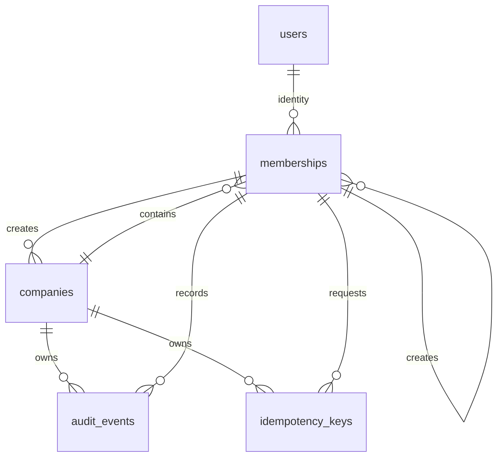

# Core tenancy schema (#12)

Global `users` represent identities; a unique `(company_id, user_id)` membership
holds each identity's company role (`owner`, `manager`, `accountant`, `employee`,
`subcontractor`). Roles never belong to the global user. Company-owned tables
carry explicit company and creator references. A creator references a membership
in that same company through a composite foreign key.

Create an identity, company and first owner membership in **one transaction**.
The company's creator foreign key is `DEFERRABLE INITIALLY DEFERRED`; the first
owner membership can name itself as creator. Committing without that membership
fails. Global identities may have a nullable self-referencing creator for initial
bootstrap or external identity-provider registration. Other creators are required.
No auth service, invitations or account provisioning endpoint is introduced here.

Timestamps use `timestamptz(3)` (absolute instants); display timezone belongs to the
UI. Database triggers update `updated_at` for SQL and Prisma writers. Demo status
is company-wide; consumers must show the required demo indicator when displaying
records of a demo company. All test identities use synthetic `example.test` emails.
Emails must be lowercase, trimmed and contain no whitespace; this constraint is
not email validation or a provider-specific identity canonicalization algorithm.

## Audit retention and access

`audit_events` records a company, member actor, action, target, metadata and creation
time. A statement trigger rejects UPDATE, DELETE and TRUNCATE, even zero-row
operations. Foreign keys use NO ACTION: removing a company or actor cannot cascade
away audit history. Deactivate memberships instead of deleting historical actors.
There is no routine audit cleanup/retention job in this milestone. Store minimal
metadata: never secrets, tokens or unnecessary personal data.

Database owners/superusers can change DDL and disable triggers. Production runtime
roles must not own tables or have migration/DDL privileges; operational role
provisioning and backup/restore belong to deployment/security work. These triggers
protect ordinary DML; they are not a claim of tamper resistance against a DB admin.

These constraints enforce referential tenant integrity, **not read authorization**.
Every service query still needs explicit company/object/role checks (#14); no RLS
or application access policy is supplied here. Transactional audit recording for
business operations belongs to #15. Inactive actors remain valid historical FK
targets; authorization must reject new operations by inactive members.

## Idempotency contract

`(company_id, key)` is unique, permitting the same opaque key in different companies.
`request_hash` is a lowercase 64-character SHA-256 fingerprint of the canonical
request (canonicalization is the future service's responsibility). A pending key
has no response. A completed key has an HTTP status (100–599) and a JSON response;
JSON `null` is a valid body, SQL NULL means no response has been stored.

Uniqueness arbitrates concurrent inserts. Services must transactionally persist the
business change and completed outcome, compare request hashes on replay, and handle
pending requests. This schema alone does not implement payment replay, expiry,
status transitions or exactly-once external effects. Those belong to the operation's
service and tests. There is no automatic key expiry or history deletion policy.

## Index rationale

- Unique user email: identity lookup; user creator index: creator FK/history lookup.
- Unique company/user membership: tenant membership lookup and composite FK target.
- Membership user index: companies accessible to an identity.
- Company/creator indexes on owned tables: actor history and FK checks.
- Audit company/time/id index: stable company history pagination.
- Audit company/target type/target ID index: object history lookup.
- Unique company/key index: idempotency lookup and concurrent duplicate prevention.

## Migration verification

Run `pnpm typecheck`, `pnpm db:validate`, and `pnpm test:integration` as described in
[database setup](database-setup.md). The integration harness creates an independent
PostgreSQL database, deploys every migration and drops that database afterward.
Tests exercise Prisma writes, transaction bootstrap, constraints, immutable audit
history and company-scoped idempotency outcomes.

`tenancy-migration.test.ts` creates a **second empty disposable database** to prove
forward/down/forward DDL execution without disturbing concurrent test files. The
rollback SQL lives in `packages/database/prisma/rollbacks/` outside Prisma's forward
migration chain. It destroys tenancy data and is only a test fixture, not a supported
production rollback command. Prisma's ledger is retained during this DDL proof;
normal deploys remain forward-only as specified by ADR 0002. An actual rollback of
production data requires a reviewed recovery/restore plan. Never run this fixture
against a shared development or production database.
