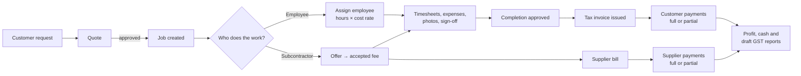
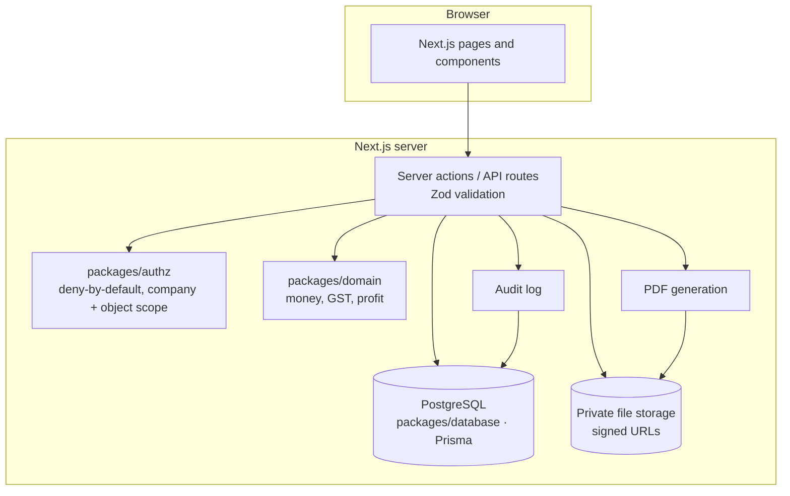
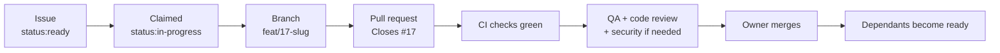

# JobFlow — Project Plan

**Repository:** https://github.com/arvindjonn09/tax-invoice · **Issues:** https://github.com/arvindjonn09/tax-invoice/issues
**Last updated:** 22 October 2026 · **Status:** planning complete; development starts at Milestone 0

This is the single overview of the project: what we're building, why, how it's designed, how the work is organised,
and how we'll know it's finished. The detailed rules live in the documents linked from each section. If this plan and a
detailed document disagree, the detailed document wins and this plan should be corrected.

---

## Contents
1. [Vision and end goals](#1-vision-and-end-goals)
2. [Scope](#2-scope)
3. [Users and permissions](#3-users-and-permissions)
4. [Business workflow](#4-business-workflow)
5. [Modules](#5-modules)
6. [Money, profit and GST rules](#6-money-profit-and-gst-rules)
7. [Acceptance tests that define "correct"](#7-acceptance-tests-that-define-correct)
8. [Architecture](#8-architecture)
9. [Data model](#9-data-model)
10. [Security and privacy](#10-security-and-privacy)
11. [User interface design](#11-user-interface-design)
12. [Demo data](#12-demo-data)
13. [How the work is organised](#13-how-the-work-is-organised)
14. [Milestones and issues](#14-milestones-and-issues)
15. [Quality gates](#15-quality-gates)
16. [Environments, deployment and operations](#16-environments-deployment-and-operations)
17. [Who builds it: Claude agents and Codex](#17-who-builds-it-claude-agents-and-codex)
18. [Owner checkpoints](#18-owner-checkpoints)
19. [Risks and how we handle them](#19-risks-and-how-we-handle-them)
20. [Open questions](#20-open-questions)
21. [Glossary](#21-glossary)
22. [Document map](#22-document-map)

---

## 1. Vision and end goals

**JobFlow** is a web application for a small Australian contracting business. It does the core job-tracking parts of
something like MYOB Business Pro, built around how this business actually works: jobs come in from customers, the
work is done by employees or by subcontractors hired as needed, the business invoices the customer and pays the
workers.

**The owner should be able to answer, at any time and for any job:**
- How much did we quote, invoice and receive?
- How much did it cost us — committed, incurred and actually paid?
- What is the real profit and margin?
- Who owes us money, and whom do we owe?
- What is our draft GST position for the period?

**End goals (version 1 is done when all of these are true):**

| # | Goal | Measured by |
|---|---|---|
| G1 | Every dollar received, spent, owed and earned is tracked per job | Critical acceptance test passes end to end (#59) |
| G2 | Job profit is correct and never distorted by GST or by the timing of payments | Combined GST + profit fixtures pass (#17, #54, #55) |
| G3 | Compliant Australian tax invoices, and draft GST/BAS figures the accountant can check | Accountant sign-off (#67) |
| G4 | Workers see only what they should | Permission and data-exposure tests, security audits (#43, #53, #61) |
| G5 | Financial records can't be silently changed or lost | Audit log, immutability tests, restore drill (#15, #52, #63) |
| G6 | Professional, accessible, mobile-friendly interface | Accessibility audit (#60), owner review of design (#23) |
| G7 | Running safely on a staging server with synthetic data, ready for a real pilot | Staging deploy and smoke test (#64, #65) |

**Growth path (after v1):** more employees and users, multiple companies (the database already carries `company_id`
everywhere), MYOB/Xero integration, offline mobile use.

---

## 2. Scope

### In version 1
- Customers, quotes, jobs, employees, subcontractors, expenses, supplier bills, customer invoices, payments, documents,
  reports, dashboard, administration.
- **Australian GST:** taxable / GST-free / input-taxed / out-of-scope lines; prices entered with or without GST; tax
  invoices; creditable GST on purchases; cash or accrual (non-cash) basis; period locking; **draft** GST/BAS summary
  (G1, 1A, 1B) and accountant export.
- PDF invoices and credit notes; CSV exports.
- Currency: AUD only.

### Not in version 1
- Lodging the BAS or any tax return with the ATO.
- Superannuation, PAYG withholding, Single Touch Payroll, payroll runs.
- Paying suppliers directly from the app (bank payment initiation).
- MYOB/Xero integration, AI features, offline mobile.

> **Important:** GST/BAS figures are drafts for an accountant or registered tax agent to review. Leaving payroll and
> super out of the app does not remove the business's legal obligations for them.

Detail: [docs/REQUIREMENTS.md](docs/REQUIREMENTS.md), [docs/GST.md](docs/GST.md)

---

## 3. Users and permissions

| Role | Can do | Must never see |
|---|---|---|
| **Owner** | Everything | — |
| **Manager** | Jobs, assign work, approve costs, view job profit | Owner-only settings |
| **Accountant** (bookkeeper) | Invoices, bills, payments, reports, GST settings review, draft GST/BAS export | — |
| **Employee** | Their assigned jobs; log hours; upload receipts and completion evidence | Customer prices, profit, other people's cost rates |
| **Subcontractor** | Their own offers and jobs; submit bills and evidence | Customer prices, margins, other contractors and their rates |

Every check happens **on the server**, denies by default, and is scoped to the user's company and to the specific
record. Hiding a button is never the protection.

Version 1 serves one company, but every table carries `company_id` so more companies can be added later without a
rewrite.

---

## 4. Business workflow



Job statuses: `draft → quoted → approved → assigned → in_progress → awaiting_review → completed → invoiced → closed`,
or `cancelled` at any point (real costs are kept). Every status change is recorded permanently.

---

## 5. Modules

| Module | What it does | Milestone |
|---|---|---|
| Administration | Users, roles, company profile, ABN, GST registration, numbering, audit history | M0–M1 |
| Customers | Companies, contacts, service locations, history | M1 |
| Jobs | Work orders, numbers, statuses, visits, assignments, documents, job finances | M1 |
| Employees | Records, assignments, timesheets, historical cost rates (no payroll) | M1–M2 |
| Subcontractors | Directory, offers, accepted rates, restricted portal | M2 |
| Expenses | Materials, travel, parking, equipment, misc. — with GST code and receipts | M2 |
| Documents | Photos, receipts, signatures, tax invoices — private, signed links | M2 |
| Quotes | Quote builder, revisions, approval, convert to job | M3 |
| Supplier bills | What we owe; creditable GST; partial payments | M3 |
| Invoices | Tax invoices, PDF, credit notes, voids, partial receipts | M3 |
| Payments | Customer receipts and supplier payments, allocations | M3 |
| Profitability | Profit by job, customer, worker, month, year | M4 |
| GST | Draft GST/BAS, period lock, adjustments, accountant export | M4 |
| Reports | Revenue, cash, ageing, profitability, CSV | M4 |
| Dashboard | Owner's daily view | Preview M0 → real M4 |

---

## 6. Money, profit and GST rules

These are the rules that make the numbers trustworthy. Detail: [docs/DATA_MODEL.md](docs/DATA_MODEL.md),
[docs/GST.md](docs/GST.md).

### Storing money
- AUD stored as **whole cents** (integers). **Never floating point.**
- Accepted prices, cost rates and GST rates are **snapshotted** when accepted or issued, so later changes never rewrite history.

### Separate financial events — never mix them
| Term | Meaning |
|---|---|
| Quoted / estimated | What we expect from an accepted quote |
| Committed cost | What we've agreed to spend (e.g. accepted subcontractor offer), not yet incurred |
| Incurred cost | Cost that has happened: approved timesheets, approved expenses, recognised bills |
| Paid | Cash actually paid out |
| Invoiced revenue | Issued invoices minus credit notes |
| Received | Cash actually received |

- **Gross job profit = invoiced revenue − incurred cost.** Margin = profit ÷ revenue (N/A when revenue is zero).
- **Profit is never calculated from cash received.**
- A supplier bill and its payment are **two events, one cost** — paying a bill never adds cost again.
- Customer outstanding = invoices − credits − receipts. Supplier outstanding = bills − credits − payments.
- Cash position = receipts − payments. This is **not** profit.

### GST and profit — built and tested together
- Profit uses **GST-exclusive** amounts.
- **Recoverable GST is never revenue, profit or expense.** GST charged to customers belongs to the ATO; creditable GST
  on purchases is claimed back.
- Only **non-creditable** GST (e.g. no valid tax invoice) is added to job cost.
- The GST code and the profit code live in one package (`packages/domain`) with one shared set of fixtures. A change
  to either must keep both passing.

### GST details
- Line codes: `TAXABLE_10` (10%), `GST_FREE`, `INPUT_TAXED`, `OUT_OF_SCOPE`.
- Prices can be entered with or without GST; each line stores ex-GST, GST and incl-GST amounts plus the rate used.
- Registered business → **"Tax Invoice"** with required fields (validated before issue). Not registered → **"Invoice"**
  with no GST.
- GST registration and accounting basis (cash or non-cash) are effective-dated.
- Draft BAS labels: **G1** total sales, **1A** GST on sales, **1B** GST credits on purchases. Net = 1A − 1B ± adjustments.
- Periods can be finalised and locked; corrections afterwards are recorded adjustments, never edits.

### Corrections
Issued invoices and approved financial records are never edited or deleted. Fix mistakes with credit notes, voids or
reversals, each with an audit entry.

### Safety
Multi-record changes run in database transactions. Payments use idempotency keys, so a double-click or retry can't
pay twice. Over-allocation and overpayment are rejected.

---

## 7. Acceptance tests that define "correct"

### Core test — business not registered for GST (or GST-exclusive figures)

| Step | Expected |
|---|---|
| Job priced at $2,500; subcontractor $900; labour $300; materials $150; travel $100 | Cost **$1,450**, profit **$1,050**, margin **42%** |
| Invoice $2,500; customer pays $1,000 | Customer owes **$1,500**; profit still $1,050 |
| Pay $400 of the $900 subcontractor bill | We owe **$500**; cost still $1,450; profit still $1,050 |

### Same job — business registered for GST
*(Verified for ordinary supplies on 22 October 2026; [rules and assumptions](docs/research/domain-gst-profit.md). Accountant review remains required.)*

| Item | Ex GST | GST | Incl GST | Job cost |
|---|---|---|---|---|
| Customer tax invoice | 2,500.00 | 250.00 | 2,750.00 | — |
| Subcontractor bill (valid tax invoice) | 900.00 | 90.00 | 990.00 | 900.00 |
| Employee labour | 300.00 | — | — | 300.00 |
| Materials (valid tax invoice) | 150.00 | 15.00 | 165.00 | 150.00 |
| Travel (no GST) | 100.00 | — | 100.00 | 100.00 |

Expected: cost **$1,450**, profit **$1,050**, margin **42%** (GST doesn't change profit) · draft GST 1A $250, 1B $105,
net **$145** · customer pays $1,000 → owes **$1,750** · pay $400 of $990 bill → we owe **$590** · if the materials GST
isn't creditable → cost $1,465, profit $1,035.

### Also tested
Duplicate payment submissions, negative and zero amounts, very large numbers, unauthorised and cross-company access,
overpayments, voids after payment, credit notes, refunds, rate changes not altering history, registration-date
boundaries, cash vs non-cash GST, locked periods, and report totals reconciling with the underlying records.

---

## 8. Architecture

**Style:** a *modular monolith* — one application, cleanly separated by feature. Simpler to build, test and run than
microservices, and enough for this business for years.

| Layer | Technology |
|---|---|
| Frontend | Next.js (App Router), React, TypeScript (strict) |
| Styling | Tailwind CSS, shadcn/ui, Radix primitives |
| Server | Next.js server actions/API routes with a service layer; Zod validation |
| Database | PostgreSQL with Prisma migrations |
| Authentication | Auth.js (or an equivalent maintained library) |
| Files | S3-compatible private storage (MinIO locally) with signed, expiring links |
| PDFs | Generated on the server, snapshotted at issue |
| Background jobs | Not in v1; add a Redis-backed queue only if needed |
| Tests | Vitest (unit/integration), Playwright (end to end) |
| Hosting | Docker on Ubuntu, nginx, HTTPS |
| CI | GitHub Actions |



**Planned folder layout**
```text
apps/web/src/app/                    pages and routes
apps/web/src/features/<module>/      dashboard, customers, jobs, quotes, employees,
                                     contractors, costs, invoices, payments, reports
packages/database/                   Prisma schema, migrations, seed
packages/domain/                     money, GST and profit calculations (pure, heavily tested)
packages/authz/                      permission policies
packages/shared-types/               shared TypeScript types
infra/docker/, infra/nginx/          deployment
tests/                               cross-module and end-to-end tests
docs/                                specification, ADRs, research, design, security, testing
```

The stack is recorded formally in `docs/adr/0001-tech-stack.md` (issue #8). Detail:
[docs/ARCHITECTURE.md](docs/ARCHITECTURE.md)

---

## 9. Data model

Main tables: companies, company GST registrations, GST periods, users, memberships (roles), customers, contacts,
locations, quotes and quote items, jobs, job visits, job status events, assignments, employees, employee rate history,
timesheets, contractors, contractor offers and acceptances, job costs, supplier bills and items, supplier payments and
allocations, invoices and items, credit notes, customer receipts and allocations, GST adjustments, documents, audit
events, idempotency keys.

Rules for every financial record: unique ID, `company_id`, currency, timestamp, creator, approval status; foreign
keys so nothing is orphaned; dates stored in UTC and shown in Australia/Sydney time; invoice and job numbers unique and
sequential per company. Every invoice, quote, bill and expense line stores tax code, GST rate, ex-GST, GST and incl-GST
amounts (and for purchases, the creditable portion).

Detail: [docs/DATA_MODEL.md](docs/DATA_MODEL.md)

---

## 10. Security and privacy

- Secure login with strong password hashing, safe session cookies, CSRF protection, login rate limiting; MFA for
  privileged users where possible.
- Server-side, deny-by-default authorisation on every page, API, report, export and file download; forged company or
  record IDs are rejected.
- Subcontractors and employees can't see prices, margins or other workers' data — proven by tests.
- Immutable audit log for financial and permission changes.
- Files private; type and size checked; downloaded only through short-lived signed links.
- ABNs, bank and contact details treated as sensitive; never logged; never real in tests or seeds.
- No secrets in Git; separate keys per environment; least-privilege database user; TLS; encrypted backups with
  tested restores.
- Records retention: business records generally 5 years, workplace records generally 7 years.
- Security reviews at M2 (#43), M3 (#53) and before production (#61); threat model in M0 (#24).

Detail: [docs/SECURITY.md](docs/SECURITY.md)

---

## 11. User interface design

**Look and feel:** trustworthy, modern, uncluttered — an accounting and field-operations tool, not a marketing site.
Original design; nothing copied from MYOB or competitors.

- Neutral slate surfaces, navy/blue primary, green = good, amber = pending, red = overdue/destructive. Status is never
  shown by colour alone.
- Light theme by default plus a full dark theme. Geist or Inter font with tabular (aligned) numbers.
- Collapsible sidebar on desktop, mobile navigation on phones; works from 360px to 1440px wide.
- WCAG 2.2 AA accessibility: keyboard use, screen-reader labels, visible focus, good contrast, large touch targets.
- Money always clearly labelled: **ex GST vs incl GST, paid vs incurred, actual vs projected**. Every financial form
  shows its GST breakdown.
- Every screen has loading, empty, error and success states. No button pretends to work when it doesn't.

**Reusable components:** AppShell, SidebarNav, PageHeader, Breadcrumbs, KPIStat, DataTable, FilterBar, EmptyState,
ErrorState, StatusPill, MoneyDisplay, FormField, DateRangePicker, ConfirmDialog, Drawer, ActivityTimeline,
FileUploader, InvoiceLineEditor, TaxCodeSelect, JobProfitBreakdown.

**How the UI is rolled out**
1. **M0:** design system, app shell, "Demo Data" banner, and **design previews** of the dashboard and invoice builder
   — static, clearly labelled "Design preview — not real data", no money logic. **The owner reviews these.**
2. **M1–M3:** each screen is built when its backend module is ready. The real invoice builder arrives in M3 (#49).
3. **M4:** the real dashboard (#57) replaces the preview.

**UI acceptance:** owner reaches an overdue invoice from the dashboard in two clicks; a manager sees projected vs
incurred costs on a job; an employee sees only their assignments; a subcontractor can't see margin; the accountant can
inspect GST and export draft reports.

Detail: [docs/UI_DESIGN.md](docs/UI_DESIGN.md)

---

## 12. Demo data

- Realistic **synthetic** data stored in the real database (so the real calculations run on it), flagged as demo.
- A persistent **"Demo Data"** banner appears on every page while demo records exist, so they can't be mistaken for
  real business records.
- One demo login per role, for testing permissions.
- Demo seeding **refuses to run in production**. No real names, addresses, ABNs or customer data, ever.

---

## 13. How the work is organised

All work lives in **GitHub Issues**. One issue = one task = one pull request.



- **Milestones:** M0 → M5 as GitHub milestones; each has an **epic** issue (#2–#7) listing its tasks.
- **Labels:**
  - Area: `frontend` `backend` `database` `security` `gst` `testing` `documentation` `infra` `design`
  - Owner: `agent:<role>` (which specialist does it)
  - Type: `type:epic|feature|bug|spike|chore|docs|design`
  - Status: `status:ready|in-progress|in-review|blocked|needs-info` (no status = waiting on dependencies)
  - Priority: `priority:p0` (urgent) … `priority:p3`
- **Branches:** `<type>/<issue>-<slug>`, never commit to `main`.
- **Commits:** Conventional Commits mentioning the issue, e.g. `feat(invoices): validate tax invoice fields (#47)`.
- **PRs:** use the template — summary, acceptance-criteria checklist, real test output, screenshots for UI.
- Only the owner merges.

---

## 14. Milestones and issues

Each milestone is built in order. Within a milestone, an issue starts when the issues on its "Depends on" line are
closed.

### M0 — Foundation · epic [#2](https://github.com/arvindjonn09/tax-invoice/issues/2)
| # | Task | Owner role |
|---|---|---|
| #8 | Tech-stack ADR and monorepo scaffold | architect |
| #9 | Docker Compose PostgreSQL and Prisma | database-engineer |
| #10 | CI with quality and security gates; protect `main` | devops-engineer |
| #11 | Test infrastructure (Vitest, Playwright, DB harness) | qa-engineer |
| #12 | Core tenancy schema (companies, users, roles, audit, idempotency) | database-engineer |
| #13 | Authentication, sessions, login throttling | backend-engineer |
| #14 | Authorisation framework | backend-engineer |
| #15 | Audit log service | backend-engineer |
| #16 | **Verify GST and profit rules against ATO sources** | domain-expert |
| #17 | **Money, GST and job-profit calculation core** | backend-engineer |
| #18 | Design system specification | ui-ux-designer |
| #19 | Design tokens, themes, shadcn/ui | frontend-engineer |
| #20 | App shell, role-aware navigation, Demo Data banner | frontend-engineer |
| #21 | Database-backed synthetic demo data | engineer |
| #22 | Dashboard and invoice-builder screen specs | ui-ux-designer |
| #23 | Dashboard and invoice-builder **design previews** | frontend-engineer |
| #24 | Threat model | security-engineer |

### M1 — Customers and jobs · epic [#3](https://github.com/arvindjonn09/tax-invoice/issues/3)
#25 company profile and GST registration settings · #26 settings screens · #27 user and role management ·
#28 customers API · #29 customer screens · #30 employee records · #31 jobs (numbering, statuses, visits, history) ·
#32 assignments and employee visibility · #33 job screens

### M2 — Contractors and expenses · epic [#4](https://github.com/arvindjonn09/tax-invoice/issues/4)
#34 private document storage · #35 contractors, offers, acceptances · #36 contractor screens ·
#37 restricted subcontractor portal · #38 cost-rate history and timesheets · #39 timesheet screens ·
#40 expenses with GST and approvals · #41 expense screens · #42 work evidence and completion · #43 security review

### M3 — Invoices and payments · epic [#5](https://github.com/arvindjonn09/tax-invoice/issues/5)
#44 quotes · #45 quote builder · #46 supplier bills with creditable GST · #47 tax invoices, credits, voids ·
#48 invoice PDFs · #49 real invoice builder · #50 customer receipts · #51 bills and payments screens ·
#52 concurrency/idempotency test suite · #53 security review

### M4 — Profit and GST reporting · epic [#6](https://github.com/arvindjonn09/tax-invoice/issues/6)
#54 job profitability service · #55 draft GST/BAS, period lock, adjustments · #56 ageing, cash, exports ·
#57 real dashboard · #58 report screens · #59 **end-to-end critical acceptance test**

### M5 — Production pilot · epic [#7](https://github.com/arvindjonn09/tax-invoice/issues/7)
#60 accessibility audit · #61 pre-production security audit · #62 retention and data export ·
#63 backups and restore drill · #64 staging deployment · #65 staging smoke test · #66 runbooks and user guides ·
#67 **accountant review of GST outputs**

Checklist version: [docs/IMPLEMENTATION_PLAN.md](docs/IMPLEMENTATION_PLAN.md)

---

## 15. Quality gates

Every application pull request must pass, in CI, before it can merge:
- TypeScript strict type-check
- Lint
- Unit and integration tests (including permission and tenant-isolation tests)
- Build
- Security checks: dependency audit, secret scanning, static analysis (CodeQL)

Also required:
- Database migrations in version control
- Schema validation on every write
- Unit tests for every financial calculation; GST and profit fixtures always run together
- End-to-end tests for the main workflow
- Accessible UI with all states
- No feature is "done" without passing tests
- No demo credentials in production

`main` is protected so these checks are enforced (set up in #10 once CI exists, with owner approval).

---

## 16. Environments, deployment and operations

| Environment | Purpose | Data |
|---|---|---|
| Local | Development (Docker Compose: app, PostgreSQL, MinIO) | Synthetic demo data |
| Staging | Production-like testing and pilot rehearsal | Synthetic demo data only |
| Production | Real use, after M5 sign-off | Real data; no demo seeding |

Each environment has its own database, file storage and secrets. Production uses HTTPS, a least-privilege database
user, daily encrypted backups with tested restores, health checks, logs without sensitive data, and monitoring.
A deployment and rollback runbook is written in #66.

---

## 17. Who builds it: Claude agents and Codex

### The specialist roles
Each issue is labelled with the role that owns it. The role instructions are in `.claude/agents/`, and **both Claude
and Codex follow them**.

| Role | Responsibility |
|---|---|
| orchestrator | Breaks goals into issues, dispatches roles, verifies, reports |
| product-analyst | User stories and acceptance criteria |
| research-dev | Technical spikes and prototypes |
| domain-expert | Australian GST and tax-invoice rules from ATO sources |
| architect | Architecture decisions, data model, contracts |
| ui-ux-designer | Flows, screen specs, design system, accessibility |
| database-engineer | Schema, migrations, constraints, seeds |
| backend-engineer | Services, APIs, business logic, PDFs |
| frontend-engineer | Screens and components |
| engineer | Glue work, small fixes |
| qa-engineer | Test plans and verification |
| code-reviewer | Reviews pull requests |
| security-engineer | Threat models, security reviews |
| devops-engineer | CI/CD, Docker, deployment, backups |
| tech-writer | Documentation |

### Instruction files
| File | Read by | Contains |
|---|---|---|
| `AGENTS.md` | Codex (automatically) and Claude | Product and engineering rules |
| `CLAUDE.md` | Claude (automatically) and Codex | Team workflow, labels, branches, PRs |
| `.claude/agents/*.md` | Claude and Codex | Role instructions |
| `docs/CODEX_PROMPTS.md` | You → Codex | Prompts that start and continue Codex |

`AGENTS.md` and `CLAUDE.md` must always agree; change one, check the other.

### Using Codex (main builder)
Copy the prompts from [docs/CODEX_PROMPTS.md](docs/CODEX_PROMPTS.md):
- **Prompt 1** starts Codex on the whole plan (begins at #8).
- **Prompt 2** for each next issue.
- **Prompt 3** to fix review feedback.

### Using Claude (optional, alongside)
- `claude --agent orchestrator` — run the whole team.
- *"use the code-reviewer agent on PR #N"* — review a Codex PR.
- `/work-issue <n>` — take one issue to a reviewed PR.
- `/plan-feature <idea>` — turn a new idea into issues.

---

## 18. Owner checkpoints

You (the owner) are needed at these points:

| When | What you do |
|---|---|
| Now | Merge PR #1, then PR #68 |
| Every PR | Review and merge (optionally after a Claude code review) |
| #10 | Approve branch protection settings for `main` |
| #16 | Confirm any GST questions the domain-expert raises |
| #22, #23 | Review the dashboard and invoice-builder design |
| #67 | Get your accountant or tax agent to review GST outputs and sign off |
| Before production | Approve deployment, costs and go-live |

---

## 19. Risks and how we handle them

| Risk | Mitigation |
|---|---|
| GST rules misunderstood | ATO-sourced rules (#16), shared GST + profit fixtures, accountant sign-off (#67) |
| Profit distorted by GST or payment timing | Single domain package, explicit tests that GST and payments never change profit |
| Rounding errors | Integer cents, pinned rounding rules, boundary tests |
| Workers see confidential prices or profit | Server-side redaction, response-shape tests, security reviews |
| Duplicate or lost payments | Idempotency keys, transactions, concurrency tests |
| Silent changes to financial history | Immutability, credit/void/reversal, audit log |
| Demo data mistaken for real | Database flag, persistent banner, production guard |
| Data loss | Encrypted backups, rehearsed restore drill |
| Large untested changes | One issue per PR, CI gates, owner merges only |
| Design drift or copying competitors | Design system first, owner review of previews, licence checks |
| Instructions drifting apart | `AGENTS.md` ↔ `CLAUDE.md` consistency rule; this plan points to the source docs |

---

## 20. Open questions

| Question | Resolved in |
|---|---|
| Exact rounding rules (per line vs per invoice; cash-basis attribution) | #16 |
| Final confirmation of the GST-registered fixture | #16 |
| Tax-invoice required fields and thresholds to enforce | #16 |
| Whether the business is GST-registered, and on cash or non-cash basis | Owner, during #25 |
| Final label for the accountant role ("Accountant" vs "Bookkeeper") | Owner (currently "Accountant") |
| Hosting provider for staging/production | #64 |

---

## 21. Glossary

| Term | Meaning |
|---|---|
| ABN | Australian Business Number |
| ATO | Australian Taxation Office |
| BAS | Business Activity Statement — the periodic GST report to the ATO (the app drafts it; it doesn't lodge it) |
| G1 / 1A / 1B | BAS labels: total sales / GST on sales / GST credits on purchases |
| GST | Goods and Services Tax, 10% in Australia |
| Ex GST / incl GST | Amount before / including GST |
| Creditable GST | GST on a purchase the business can claim back |
| Non-creditable GST | GST that can't be claimed back — it becomes part of the cost |
| Tax invoice | An invoice meeting ATO requirements, issued by a GST-registered business |
| Cash / non-cash basis | When GST is counted: when paid, or when invoiced |
| Committed / incurred / paid | Agreed to spend / has been spent / cash has left |
| Idempotency key | A unique token that stops a retried request (e.g. double-click) from paying twice |
| Modular monolith | One application organised into separate feature modules |
| ADR | Architecture Decision Record |
| Epic | A parent issue that groups the tasks of a milestone |

---

## 22. Document map

| Document | Purpose |
|---|---|
| [plan.md](plan.md) | This overview |
| [README.md](README.md) | Original build plan |
| [AGENTS.md](AGENTS.md) | Rules for all AI coding agents |
| [CLAUDE.md](CLAUDE.md) | Team workflow for Claude |
| [docs/REQUIREMENTS.md](docs/REQUIREMENTS.md) | Roles, modules, business rules |
| [docs/GST.md](docs/GST.md) | Australian GST rules and fixtures |
| [docs/DATA_MODEL.md](docs/DATA_MODEL.md) | Tables and financial definitions |
| [docs/ARCHITECTURE.md](docs/ARCHITECTURE.md) | Technical design |
| [docs/SECURITY.md](docs/SECURITY.md) | Security and operations |
| [docs/UI_DESIGN.md](docs/UI_DESIGN.md) | Design system and screens |
| [docs/IMPLEMENTATION_PLAN.md](docs/IMPLEMENTATION_PLAN.md) | Milestone checklist |
| [docs/CODEX_PROMPTS.md](docs/CODEX_PROMPTS.md) | Prompts for Codex |
| `.claude/agents/` | Role instructions |
| `.github/` | Issue and PR templates |
| `scripts/setup-labels.sh` | Creates the GitHub labels |
